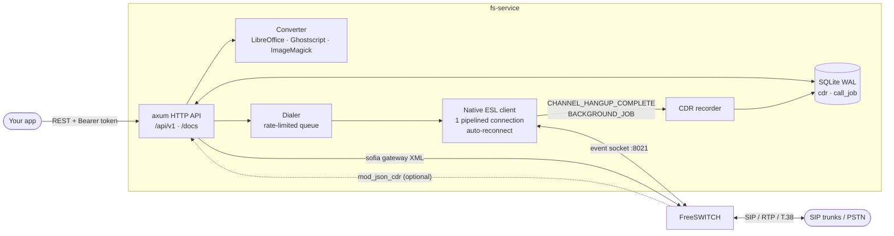

<div align="center">

# fs-service

**A fast, secure REST gateway for [FreeSWITCH](https://signalwire.com/freeswitch).**
Manage SIP trunks, broadcast faxes and voice messages, receive faxes, and keep a complete call log —
from one 7 MB binary with a built-in OpenAPI explorer.

[](https://github.com/101t/fs-service/actions/workflows/ci.yml)


[](LICENSE)

</div>

```bash
# fax a Word document to two numbers through your SIP trunk
curl -H "Authorization: Bearer $TOKEN" -F file=@invoice.docx localhost:8080/api/v1/files
# → {"name":"0193a5c2-….docx","size":48211,"kind":"document"}

curl -H "Authorization: Bearer $TOKEN" -H 'Content-Type: application/json' localhost:8080/api/v1/calls/fax \
     -d '{"gateway":"trunk1","file":"0193a5c2-….docx","numbers":["902129998877","902129998878"]}'
# → 202 {"batch_id":"0193a5c3-…","calls":[…]}   then poll GET /api/v1/batches/{batch_id}
```

---

## Why fs-service

FreeSWITCH is a superb telephony engine, but driving it from an application means learning the
event socket protocol, Sofia's XML, spandsp's fax quirks and how to collect CDRs. fs-service wraps
all of that in a small, documented HTTP API.

| | |
|---|---|
| 📠 **Fax broadcast** | Send PDF, Word, Excel, PowerPoint, OpenDocument, text, HTML or images. Converted to a spec-exact fax TIFF (1728 px, CCITT G4, fine or normal) and sent over T.38 or G.711. |
| 📥 **Fax inbox** | Received faxes listed with sender, pages and result; download as TIFF or PDF. |
| 🔊 **Voice broadcast** | Play a WAV/MP3 to a list of numbers. |
| 📊 **Delivery reports** | Every request is a *batch*; see per-call state: queued, in progress, delivered, failed (with the reason). |
| ☎️ **SIP trunk management** | Create, update, inspect (live registration state) and delete Sofia gateways. No manual XML, no `fs_cli`. |
| 🧾 **Built-in CDR logger** | Every call on the switch is recorded into SQLite — live from the event socket, and optionally via mod_json_cdr for zero-loss capture. Searchable over the API. |
| 📖 **Self-documenting** | OpenAPI 3.1 at `/openapi.json`, interactive explorer at `/docs`. |

## How it works



* **One event socket connection** carries every command and event. Commands are pipelined
  (FreeSWITCH replies in order), so API requests never wait on each other, and the client
  reconnects on its own with exponential backoff.
* **Each originated call gets a UUID we choose** (`origination_uuid`, also the `bgapi` Job-UUID)
  and a `fss_batch_id` channel variable. That ties requests, originate failures and CDRs together
  without polling FreeSWITCH.
* **The dialer paces calls** (`FSS_DIAL_RATE` per second, globally), so a 1,000-number batch
  does not trip FreeSWITCH's `sessions-per-second` limit.

## Quick start

### Docker Compose (FreeSWITCH + fs-service)

```bash
git clone https://github.com/101t/fs-service && cd fs-service
cp .env.example .env
#  FSS_API_TOKENS=$(openssl rand -hex 32)
#  FSS_ESL_PASSWORD=$(openssl rand -hex 24)   ← also put it in contrib/freeswitch/autoload_configs/event_socket.conf.xml
docker compose up -d --build
open http://localhost:8080/docs
```

### Docker image only

```bash
docker run -d --name fs-service --network host --env-file .env \
  -v fss-data:/var/lib/fs-service ghcr.io/101t/fs-service:2      # or :latest, :2.0, :2.0.0
```

### Next to an existing FreeSWITCH

Download the static binary from [Releases](https://github.com/101t/fs-service/releases), or build it:

```bash
cargo build --release                       # Rust 1.85+
sudo apt install libreoffice-writer-nogui libreoffice-calc-nogui libreoffice-impress-nogui \
                 ghostscript imagemagick libtiff-tools          # only needed for fax
FSS_API_TOKENS=… FSS_ESL_PASSWORD=… ./target/release/fs-service
```

A hardened systemd unit is in [`contrib/systemd/`](contrib/systemd/fs-service.service).
FreeSWITCH-side setup (event socket, received-fax dialplan, mod_json_cdr) is in
[docs/freeswitch.md](docs/freeswitch.md).

## Configuration

Every option is an environment variable and a CLI flag (`fs-service --help`).

| Variable | Default | |
|---|---|---|
| `FSS_API_TOKENS` | **required** | Comma-separated bearer tokens, ≥ 32 chars each. Several allow rotation. |
| `FSS_ESL_PASSWORD` | **required** | Event socket password. There is deliberately no default. |
| `FSS_ESL_ADDR` | `127.0.0.1:8021` | Event socket address. |
| `FSS_LISTEN` | `0.0.0.0:8080` | HTTP listen address. |
| `FSS_DATABASE_URL` | `sqlite://fs-service.db` | SQLite file for CDRs and call jobs. |
| `FSS_SIP_PROFILE` | `external` | Sofia profile that owns managed gateways. |
| `FSS_GATEWAY_DIR` | `/etc/freeswitch/sip_profiles/external` | Where `<gateway>.xml` files are written (included by the profile). |
| `FSS_OUTBOX_DIR` | `/var/lib/fs-service/outbox` | Uploads and conversions. **FreeSWITCH must see the same path.** |
| `FSS_INBOX_DIR` | `/var/lib/fs-service/inbox` | Received faxes (`rxfax-<uuid>.tiff`). |
| `FSS_MAX_UPLOAD_MB` | `25` | Upload size cap. |
| `FSS_MAX_NUMBERS` | `1000` | Numbers per call request. |
| `FSS_DIAL_RATE` | `10` | Calls started per second, across all batches. |
| `FSS_CONVERT_CONCURRENCY` | `2` | Conversions running at once. |
| `FSS_CONVERT_TIMEOUT_SECS` | `120` | Kill a stuck converter after this long. |
| `FSS_MAGICK_BIN` | `convert` | `magick` for ImageMagick 7 without the legacy alias. |
| `FSS_LOG_JSON` | `false` | JSON log lines (for Loki, ELK, …). Level via `RUST_LOG`. |

## API tour

All `/api/v1` endpoints require `Authorization: Bearer <token>`. Errors always look like
`{"error": "bad_request", "message": "…"}`. The complete, interactive reference is at **`/docs`**.

<details open>
<summary><b>Endpoints</b></summary>

| Method | Path | |
|---|---|---|
| `GET` | `/health` | Liveness + FreeSWITCH connectivity (public) |
| `GET` | `/api/v1/gateways` | List managed gateways |
| `PUT` | `/api/v1/gateways/{name}` | Create or replace a gateway and load it |
| `GET` | `/api/v1/gateways/{name}` | Config (password redacted) + live registration state |
| `DELETE` | `/api/v1/gateways/{name}` | Unload and remove |
| `POST` | `/api/v1/files` | Upload a document or audio file (multipart field `file`) |
| `GET` | `/api/v1/files/{name}` | Download; `?format=pdf\|tiff`, `?folder=inbox` |
| `POST` | `/api/v1/calls/fax` | Fax a document to numbers |
| `POST` | `/api/v1/calls/voice` | Play audio to numbers |
| `GET` | `/api/v1/batches/{batch_id}` | Delivery report |
| `GET` | `/api/v1/fax/inbox` | Received faxes |
| `GET` | `/api/v1/cdrs` | Search the call log |
| `POST` | `/api/v1/cdrs/ingest` | mod_json_cdr target |

</details>

### 1. Add a SIP trunk

```bash
curl -X PUT localhost:8080/api/v1/gateways/trunk1 -H "Authorization: Bearer $TOKEN" \
  -H 'Content-Type: application/json' -d '{
    "username": "905551112233", "password": "s3cret",
    "realm": "sip.provider.example", "register": true,
    "params": {"from-domain": "sip.provider.example", "expire-seconds": "600"}
  }'
```
```json
{"name":"trunk1","params":{"expire-seconds":"600","from-domain":"sip.provider.example",
 "password":"********","realm":"sip.provider.example","register":"true","username":"905551112233"},
 "state":"REGED","status":"UP"}
```

`PUT` is idempotent: if FreeSWITCH is unreachable you get `503`, the file is already saved, and a
retry (or the next `sofia rescan`) applies it.

### 2. Send a fax and track it

```bash
curl -F file=@contract.pdf localhost:8080/api/v1/files -H "Authorization: Bearer $TOKEN"
curl localhost:8080/api/v1/calls/fax -H "Authorization: Bearer $TOKEN" -H 'Content-Type: application/json' \
  -d '{"gateway":"trunk1","file":"0193a5c2-….pdf","numbers":["902129998877"],"caller_id":"905551112233","quality":"fine"}'
curl localhost:8080/api/v1/batches/0193a5c3-… -H "Authorization: Bearer $TOKEN"
```
```json
{"batch_id":"0193a5c3-…","kind":"fax","total":1,"queued":0,"in_progress":0,"delivered":1,"failed":0,
 "calls":[{"uuid":"0193a5c3-…","destination":"902129998877","state":"delivered","reason":null,
           "hangup_cause":"NORMAL_CLEARING","billsec":48,"fax_pages":3,"ended_at":"2026-11-20T10:15:02Z"}]}
```

A fax counts as **delivered** only when spandsp reports `fax_success=1`; a voice call when it was
answered. Failures carry a reason such as `USER_BUSY`, `INVALID_GATEWAY` or the fax result text.

Preview exactly what will be transmitted: `GET /api/v1/files/{name}?format=tiff&quality=fine`.

### 3. Read the fax inbox

```bash
curl "localhost:8080/api/v1/fax/inbox?receivers=905550000000&from=2026-11-01T00:00:00Z" -H "Authorization: Bearer $TOKEN"
curl -o fax.pdf "localhost:8080/api/v1/files/rxfax-<uuid>.tiff?folder=inbox&format=pdf" -H "Authorization: Bearer $TOKEN"
```

### 4. Query the call log

```bash
curl "localhost:8080/api/v1/cdrs?number=902129998877&from=2026-11-01T00:00:00Z&limit=50" -H "Authorization: Bearer $TOKEN"
```

Filters: `from`, `to` (RFC 3339), `number` (caller or callee), `direction`, `batch_id`, `fax_only`,
`limit` (≤ 1000), `offset`.

## The CDR logger

v1 needed mod_cdr_sqlite, the Go *cdr-pusher* daemon and a PostgreSQL side database. v2 records
CDRs itself:

1. **Live, zero config.** The recorder subscribes to `CHANNEL_HANGUP_COMPLETE` on the event
   socket and stores every call leg, API-originated or not.
2. **Durable, optional.** Point [mod_json_cdr](contrib/freeswitch/autoload_configs/json_cdr.conf.xml)
   at `/api/v1/cdrs/ingest`. FreeSWITCH retries and spools to disk, so calls that end while
   fs-service restarts are not lost.

Both feed the same table, deduplicated by call UUID. Columns: `uuid, batch_id, direction,
caller_id_name, caller_id_number, destination_number, gateway, start_at, answer_at, end_at,
duration, billsec, hangup_cause, fax_success, fax_result_text, fax_pages` — see the
[migration](migrations/20261120000000_init.sql). It is plain SQLite: query it with any tool,
back it up with `sqlite3 fs-service.db ".backup cdr.bak"`.

## Security

* **No default secrets.** The service refuses to start without an ESL password and ≥ 32-char API
  tokens; the shipped event-socket config binds to loopback with an ACL.
* **Constant-time token checks**, `Authorization` headers redacted from logs.
* **No injection paths.** Numbers, gateway names and file names are validated against strict
  allow-lists before they reach a dial string, a file path or the event socket; the ESL client
  additionally refuses any command containing a line break. Converters run without a shell.
* **No path traversal.** Uploaded files are stored under server-generated UUID names; client file
  names are never used. Downloads only serve plain names from two configured folders.
* **Secrets stay secret.** Gateway passwords are never returned by the API. Internal errors are
  logged, not leaked to clients.
* **Bounded resources.** Body size limits, request timeout, conversion timeout + concurrency cap,
  bounded queues.
* **Least privilege.** The container runs as a non-root user; the systemd unit is sandboxed.

Put fs-service behind a TLS-terminating reverse proxy when it is reachable from other hosts.
Report vulnerabilities as described in [SECURITY.md](SECURITY.md).

## Performance

* Async Rust (tokio + axum); a single binary with no runtime to install.
* One pipelined event-socket connection instead of a TCP connect + auth per request (v1).
* Originates are queued with `bgapi` and return immediately; requests answer in milliseconds.
* Conversions are cached: the first fax TIFF of a document takes ~1 s, repeats ~5 ms.
* SQLite in WAL mode with indexes for time, number and batch lookups; CDR writes never block reads.
* Time-ordered UUIDv7 keys keep inserts index-friendly.

## Development

```bash
make            # list all targets
make check      # fmt + clippy + tests, exactly what CI runs (tests include a fake FreeSWITCH)
make run        # run with settings from .env
make up         # FreeSWITCH + fs-service via docker compose
```

## Releases

Versions follow [SemVer](https://semver.org) and every release is a `vX.Y.Z` git tag.

```bash
# 1. move the "Unreleased" notes in CHANGELOG.md under "## [2.1.0] - 2026-12-01" and commit
make release-minor            # or release-patch / release-major / release VERSION=2.1.0
git push origin HEAD v2.1.0   # 2. publishing starts here
```

`make release` refuses to run with uncommitted changes, an existing tag, or a missing CHANGELOG
section. It bumps `Cargo.toml`, runs the full check, then commits and tags. The pushed tag runs
[`release.yml`](.github/workflows/release.yml), which:

1. verifies the tag matches `Cargo.toml` and runs the full check;
2. pushes `ghcr.io/101t/fs-service` tagged `2.1.0`, `2.1`, `2` and `latest`;
3. builds a static x86_64 Linux binary (musl) with a SHA-256 checksum;
4. publishes a GitHub Release with the CHANGELOG section as notes and the binary attached.

Code map:

| | |
|---|---|
| [`src/esl.rs`](src/esl.rs) | Event socket client: framing, auth, pipelining, reconnect |
| [`src/cdr.rs`](src/cdr.rs) | CDR model, event/JSON mapping, recorder task |
| [`src/dialer.rs`](src/dialer.rs) | Rate-limited originate queue |
| [`src/convert.rs`](src/convert.rs) | Document → fax TIFF / PDF pipelines |
| [`src/api/`](src/api) | HTTP handlers, auth, validation, OpenAPI |

See [CONTRIBUTING.md](CONTRIBUTING.md). Upgrading from the Django version? Read
[docs/migration-from-v1.md](docs/migration-from-v1.md).

## License

[MIT](LICENSE). Thanks to the FreeSWITCH community and to Areski Belaid, whose cdr-pusher served v1 well.
